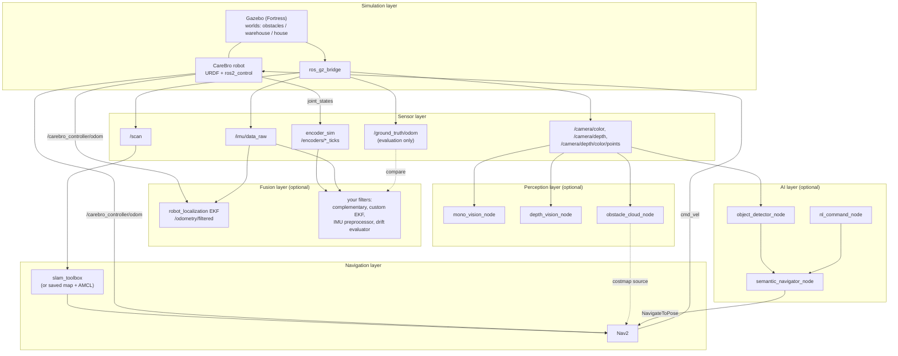

# CAREBRO_

**An open-source assistive robot platform to help people with physical disabilities live more independently.**

CAREBRO_ is a ROS 2 workspace for a small autonomous mobile robot that can navigate a home, understand its surroundings and, in future, respond to requests such as "go to the kitchen" or "bring me my water." It is built **simulation-first**, so anyone can develop and test ideas without owning hardware.

> **Safety notice:** CAREBRO_ is a research and education project. It is **not a medical device** and has not been validated for use around people. Test in simulation and under supervision before any real-world use.

<!-- Replace with your own media once ready -->
> **Demo videos:** _coming soon_
>
> | Simulation + SLAM | Autonomous navigation | Sensor fusion | AI object detection |
> |---|---|---|---|
> | _video_ | _video_ | _video_ | _video_ |

---

## Table of contents

1. [Why this project exists](#why-this-project-exists)
2. [Project goals](#project-goals)
3. [What works today](#what-works-today)
4. [Architecture](#architecture)
5. [Repository structure](#repository-structure)
6. [Requirements](#requirements)
7. [Installation](#installation)
8. [Quick start](#quick-start)
9. [Launch options](#launch-options)
10. [Topics and sensors](#topics-and-sensors)
11. [Package reference](#package-reference)
12. [Sensor fusion and drift experiments](#sensor-fusion-and-drift-experiments)
13. [Writing your own perception and AI nodes](#writing-your-own-perception-and-ai-nodes)
14. [Verifying your setup](#verifying-your-setup)
15. [Roadmap](#roadmap)
16. [Troubleshooting](#troubleshooting)
17. [Contributing](#contributing)
18. [License](#license)

---

## Why this project exists

Many people with limited mobility depend on others for everyday tasks such as fetching objects, moving around the home or calling for help. Commercial assistive robots are expensive and closed. CAREBRO_ aims to be an affordable, open and hackable alternative that researchers, students, hobbyists, caregivers and people with lived experience of disability can build on together.

## Project goals

- Reliable autonomous **indoor navigation** (SLAM + Nav2)
- Safe **obstacle handling** using LiDAR and an RGB-D camera
- **Voice and natural-language control**
- **Object recognition** for fetch-and-carry tasks
- **Low-cost hardware** that others can replicate
- A modular design where each capability can be improved independently

---

## What works today

| Component | Status |
|---|---|
| Robot model, three Gazebo worlds, diff-drive controller | Working |
| Simulated LiDAR, IMU, RGB-D camera, wheel encoders, ground truth | Implemented |
| Live SLAM + Nav2, and navigation on a saved map | Implemented |
| `robot_localization` EKF (wheel odometry + IMU) | Implemented |
| One-command bringup with layer switches | Implemented |
| Fusion nodes (5), perception nodes (3), AI nodes (3) | Templates: **contributions welcome** |
| Jazzy / Gazebo Harmonic | Code path exists, untested |
| Real hardware | Planned |

The navigation and sensor foundation is in place. The perception and AI layers are where most of the assistive features will be built, and they are ready for contributors.

---

## Architecture

CAREBRO_ is organised in layers. Each layer is its own ROS 2 package and can be switched on or off independently from the bringup launch file.



### How the layers fit together

| Layer | Packages | Purpose |
|---|---|---|
| **Simulation** | `carebro_description`, `carebro_gazebo`, `carebro_controller` | Robot model, worlds, Gazebo-to-ROS bridge, wheel controller |
| **Sensors** | `carebro_sensors` (+ sensor definitions in `carebro_description`) | Camera, IMU and encoder data in real-hardware formats |
| **Navigation** | `carebro_navigation` | SLAM, Nav2, saved-map navigation |
| **Fusion** | `carebro_sensor_fusion` | EKF configuration and your own estimation algorithms |
| **Perception** | `carebro_perception` | Vision algorithms on the camera streams |
| **AI** | `carebro_ai` | Object detection, natural-language commands, semantic navigation |
| **Orchestration** | `carebro_bringup` | One launch file that starts everything with switches |

### Frames (TF)

```
map ─▶ odom ─▶ base_footprint ─▶ base_link ─┬─▶ imu_link
                                            ├─▶ camera_link (RealSense-style)
                                            ├─▶ lidar link
                                            └─▶ wheel links
```

By default `odom → base_footprint` is published by the diff-drive controller. The EKF can take this over (see [fusion](#sensor-fusion-and-drift-experiments)).

### Startup order

`carebro_bringup` starts the base system first (Gazebo, robot, optionally SLAM and Nav2), then starts the optional layers (`sensors`, `fusion`, `perception`, `ai`) **20 seconds later**, so the simulator and controllers are ready.

---

## Repository structure

This repository contains the ROS 2 `src/` folder only. Clone it so that it becomes the `src` directory of a colcon workspace (see [Installation](#installation)).

```
src/
├── carebro_bringup/              # One-command launch with layer switches
│   ├── launch/bringup.launch.py
│   ├── CMakeLists.txt
│   └── package.xml
│
├── carebro_description/          # Robot model
│   ├── urdf/
│   │   ├── carebro.urdf.xacro        # Main robot description
│   │   ├── carebro_gazebo.xacro      # Gazebo plugins, ground-truth odometry
│   │   ├── carebro_imu.xacro         # IMU sensor (100 Hz, noise + bias)
│   │   └── carebro_realsense.xacro   # RGB-D camera (resolution, rate, range)
│   └── meshes/                       # STL meshes
│
├── carebro_gazebo/               # Simulation
│   ├── launch/sim.launch.py          # Gazebo + spawn + bridge + controllers + RViz
│   ├── worlds/
│   │   ├── obstacles.sdf
│   │   ├── warehouse.sdf
│   │   └── house.sdf
│   └── rviz/sim.rviz
│
├── carebro_controller/           # ros2_control diff-drive setup
│   └── config/carebro_controller.yaml
│
├── carebro_navigation/           # SLAM + Nav2
│   ├── launch/
│   │   ├── slam_navigation.launch.py # Live SLAM + Nav2
│   │   └── navigation.launch.py      # Saved map + AMCL + Nav2
│   ├── config/                       # nav2_params.yaml, slam_toolbox_mapping.yaml
│   └── maps/                         # Saved maps
│
├── carebro_sensors/              # Simulated sensor helpers
│   ├── carebro_sensors/encoder_sim.py    # Joint angles -> integer encoder ticks
│   ├── config/encoders.yaml
│   └── launch/sensors.launch.py
│
├── carebro_sensor_fusion/        # State estimation
│   ├── config/ekf.yaml                   # robot_localization EKF (ready to run)
│   ├── launch/fusion.launch.py
│   └── carebro_sensor_fusion/
│       ├── complementary_filter_node.py  # template
│       ├── custom_ekf_node.py            # template
│       ├── encoder_odometry_node.py      # template
│       ├── imu_preprocessor_node.py      # template
│       └── drift_evaluator_node.py       # template
│
├── carebro_perception/           # Vision (templates)
│   ├── config/perception.yaml
│   ├── launch/perception.launch.py
│   └── carebro_perception/
│       ├── mono_vision_node.py
│       ├── depth_vision_node.py
│       └── obstacle_cloud_node.py
│
└── carebro_ai/                   # AI (templates)
    ├── config/ai.yaml
    ├── launch/ai.launch.py
    ├── models/                       # Put model weights here (git-ignored)
    ├── requirements.txt
    └── carebro_ai/
        ├── object_detector_node.py
        ├── nl_command_node.py
        └── semantic_navigator_node.py
```

---

## Requirements

| Component | Version |
|---|---|
| OS | Ubuntu 22.04 |
| ROS 2 | **Humble** |
| Simulator | **Gazebo Fortress** (`ignition`) |
| Python | System Python 3.10 (`/usr/bin/python3`) |

> **Jazzy / Gazebo Harmonic:** the launch files contain a Harmonic code path (it activates automatically when `ROS_DISTRO` is not `humble`). It is **untested**, so expect to adjust it.

A machine with a dedicated GPU is recommended. If Gazebo runs slowly, lower the camera resolution and rate at the top of `carebro_description/urdf/carebro_realsense.xacro`, or launch with `gui:=false`.

---

## Installation

### 1. Install ROS 2 Humble

Follow the [official instructions](https://docs.ros.org/en/humble/Installation/Ubuntu-Install-Debians.html), then:

```bash
echo "source /opt/ros/humble/setup.bash" >> ~/.bashrc
source ~/.bashrc
```

### 2. Install dependencies

```bash
sudo apt update
sudo apt install -y \
  ros-humble-desktop \
  ros-humble-ros-gz \
  ros-humble-ign-ros2-control \
  ros-humble-ros2-control \
  ros-humble-ros2-controllers \
  ros-humble-xacro \
  ros-humble-navigation2 \
  ros-humble-nav2-bringup \
  ros-humble-nav2-simple-commander \
  ros-humble-slam-toolbox \
  ros-humble-robot-localization \
  ros-humble-vision-msgs \
  ros-humble-cv-bridge \
  ros-humble-image-tools \
  ros-humble-rqt-image-view \
  ros-humble-teleop-twist-keyboard \
  python3-opencv \
  python3-colcon-common-extensions \
  python3-rosdep
```

### 3. Clone into a workspace

The repository root becomes the workspace, so `src/` lands in the right place:

```bash
git clone https://github.com/vedant710/CAREBRO_.git ~/carebro_ws
cd ~/carebro_ws
```

Already have a workspace? Clone into a temporary folder and copy the contents of `src/` into `~/your_ws/src/`.

### 4. Resolve remaining dependencies

```bash
sudo rosdep init        # skip if already done
rosdep update
rosdep install --from-paths src --ignore-src -r -y
```

### 5. Build

```bash
cd ~/carebro_ws
colcon build --symlink-install
source install/setup.bash
```

Add the workspace to your shell so you don't have to source it every time:

```bash
echo "source ~/carebro_ws/install/setup.bash" >> ~/.bashrc
```

### 6. Optional: Python packages for the AI nodes

The AI and perception nodes run under the **system** Python, not a conda or virtualenv environment. Install libraries there:

```bash
/usr/bin/python3 -m pip install --user -r src/carebro_ai/requirements.txt
```

`requirements.txt` lists the optional libraries (commented out by default). Uncomment what you need, for example:

| Library | Use |
|---|---|
| `ultralytics` | YOLO object detection |
| `onnxruntime` | Lightweight CPU inference |
| `torch` | Only if your model needs it (large download) |
| `openai` / `anthropic` | Hosted LLMs for natural-language commands |

> If `cv_bridge` complains about NumPy 2.x, pin it: `/usr/bin/python3 -m pip install --user "numpy<2"`.
>
> **Never commit API keys.** Read them from environment variables.

### 7. Optional: reduce DDS problems on multi-process setups

Running many nodes can exhaust DDS participant slots. If you see participant-related errors, use CycloneDDS and raise `MaxAutoParticipantIndex` in a CycloneDDS XML config:

```bash
sudo apt install ros-humble-rmw-cyclonedds-cpp
export RMW_IMPLEMENTATION=rmw_cyclonedds_cpp
export CYCLONEDDS_URI=file:///path/to/cyclone.xml
```

---

## Quick start

Make sure the workspace is sourced in every new terminal.

**Simulation only** (robot in Gazebo, RViz, no navigation):

```bash
ros2 launch carebro_bringup bringup.launch.py nav_mode:=sim world:=house
```

**Live SLAM + Nav2** (build a map while navigating):

```bash
ros2 launch carebro_bringup bringup.launch.py nav_mode:=slam_nav world:=house
```

**Navigate on a saved map** (AMCL + Nav2):

```bash
ros2 launch carebro_bringup bringup.launch.py nav_mode:=navigation world:=obstacles
```

**Everything, including fusion:**

```bash
ros2 launch carebro_bringup bringup.launch.py nav_mode:=slam_nav fusion:=true
```

**Drive manually** (second terminal):

```bash
ros2 run teleop_twist_keyboard teleop_twist_keyboard
```

**Headless** (no Gazebo window, useful on slow machines or CI):

```bash
ros2 launch carebro_bringup bringup.launch.py nav_mode:=sim gui:=false
```

You can also launch the simulator alone, with a custom spawn pose:

```bash
ros2 launch carebro_gazebo sim.launch.py world:=house x:=-3.0 y:=-1.0 yaw:=0.0
```

The `house` world (rooms and furniture) is the most relevant one for assistive scenarios. `obstacles` is a simple arena for testing, and `warehouse` is a larger space.

---

## Launch options

### `carebro_bringup bringup.launch.py`

| Argument | Default | Values | Description |
|---|---|---|---|
| `nav_mode` | `slam_nav` | `sim`, `navigation`, `slam_nav` | `sim`: Gazebo and robot only. `navigation`: saved map + AMCL + Nav2. `slam_nav`: live SLAM + Nav2. |
| `world` | `obstacles` | `obstacles`, `warehouse`, `house`, or an absolute `.sdf` path | Gazebo world |
| `gui` | `true` | `true` / `false` | Show the Gazebo GUI (`false` = headless) |
| `sensors` | `true` | `true` / `false` | Start `encoder_sim` |
| `fusion` | `false` | `true` / `false` | Start the `robot_localization` EKF |
| `fusion_publish_tf` | `false` | `true` / `false` | Let the EKF publish `odom → base_footprint` |
| `perception` | `false` | `true` / `false` | Start the perception nodes |
| `ai` | `false` | `true` / `false` | Start the AI nodes |

The optional layers start 20 s after the base system.

### `carebro_gazebo sim.launch.py`

| Argument | Default | Description |
|---|---|---|
| `world` | `obstacles` | `obstacles`, `warehouse`, `house`, or an absolute `.sdf` path |
| `x`, `y`, `yaw` | per world | Spawn pose (metres, radians) |
| `rviz` | `true` | Open RViz |
| `gui` | `true` | Open the Gazebo GUI |

Default spawn poses:

| World | x | y | yaw |
|---|---|---|---|
| `obstacles` | -4.0 | -4.0 | 0.0 |
| `warehouse` | -8.5 | -5.5 | 0.0 |
| `house` | -3.0 | -1.0 | 0.0 |

---

## Topics and sensors

Camera topic names match the real `realsense2_camera` driver, so perception code written in simulation should run on hardware with little or no change.

| Sensor | Topic | Type | Notes |
|---|---|---|---|
| LiDAR | `/scan` | `sensor_msgs/LaserScan` | |
| IMU | `/imu/data_raw` | `sensor_msgs/Imu` | 100 Hz, frame `imu_link`, noise and bias modelled |
| Camera (colour) | `/camera/color/image_raw` | `sensor_msgs/Image` | `rgb8`, 640×480 @ 15 Hz |
| Camera info | `/camera/color/camera_info` | `sensor_msgs/CameraInfo` | Depth is pixel-aligned with colour |
| Camera (depth) | `/camera/depth/image_rect_raw` | `sensor_msgs/Image` | `32FC1` in **metres** in simulation. A real RealSense gives `16UC1` in **millimetres**. |
| Point cloud | `/camera/depth/color/points` | `sensor_msgs/PointCloud2` | Frame `camera_link` |
| Encoders | `/encoders/left_ticks`, `/encoders/right_ticks` | `std_msgs/Int32` | Cumulative, 1320 ticks/rev |
| Wheel odometry | `/carebro_controller/odom` | `nav_msgs/Odometry` | From `diff_drive_controller` |
| Ground truth | `/ground_truth/odom` | `nav_msgs/Odometry` | **World frame. For evaluation only.** |
| EKF output | `/odometry/filtered` | `nav_msgs/Odometry` | When `fusion:=true` |

**Camera model:** D435-style box on the front of the base, 8 cm above the floor, 69° horizontal FOV, depth range 0.3–6 m. Resolution, rate and range are properties at the top of `carebro_realsense.xacro`. No depth noise is modelled and the camera has no collision body.

**Planned topics** (produced by your node implementations): `/ai/command`, `/ai/detections`, `/ai/debug_image`, `/perception/depth/min_distance`, `/perception/obstacle_points`, `/fusion/encoder_odom`, `/fusion/custom_ekf/odom`, `/fusion/complementary/yaw`, `/imu/data`.

---

## Package reference

### `carebro_description`
Robot URDF/Xacro. The sensor definitions are split into their own files (`carebro_imu.xacro`, `carebro_realsense.xacro`) and included from `carebro.urdf.xacro`. The `is_ignition` argument switches between Gazebo Fortress (`true`, default) and Harmonic (`false`).

### `carebro_gazebo`
Starts Gazebo with the chosen world, spawns the robot, bridges Gazebo topics to ROS, starts the controllers and optionally RViz. All three worlds include the Gazebo `Imu` system plugin (the IMU publishes nothing without it).

### `carebro_controller`
`diff_drive_controller` and `joint_state_broadcaster` configuration. Wheel radius is 0.033 m and the effective track is 0.17 m. Odometry covariances are set so that fusion can weight sensors correctly.

### `carebro_navigation`
Nav2 and `slam_toolbox` launch files and parameters. Nav2 runs with `use_composition: True` (one process instead of about eight), which keeps the number of DDS participants down.

### `carebro_sensors`
`encoder_sim` subscribes to `/joint_states`, converts wheel angles into quantised tick counts and publishes `/encoders/{left,right}_ticks`.

| Parameter | Default | Description |
|---|---|---|
| `left_joint` / `right_joint` | `wheel_left_joint` / `wheel_right_joint` | Joint names |
| `ticks_per_rev` | `1320` | 11 pulses × 4 (quadrature) × 30:1 gearbox. Set to your real motor when moving to hardware. |
| `noise_std_ticks` | `0.0` | Gaussian noise added to ticks |

### `carebro_sensor_fusion`
`config/ekf.yaml` is a ready-to-run `robot_localization` EKF (30 Hz, 2D mode) that fuses:

- wheel odometry: forward velocity and yaw rate
- IMU: yaw rate

Five node templates are included for your own estimation work:

| Node | Purpose |
|---|---|
| `imu_preprocessor_node` | Remove gyro bias and set realistic covariances, then publish `/imu/data` |
| `encoder_odometry_node` | Diff-drive kinematics from raw encoder ticks |
| `complementary_filter_node` | Simple heading filter |
| `custom_ekf_node` | Your own EKF to compare with `robot_localization` |
| `drift_evaluator_node` | Position/heading error and RMSE against ground truth, CSV output |

### `carebro_perception`
Three templates for vision work: `mono_vision_node` (RGB only: features, visual odometry, ArUco, segmentation), `depth_vision_node` (nearest obstacle, cliff detection, floor-plane segmentation), `obstacle_cloud_node` (find obstacles the 2D LiDAR plane cannot see, then feed them to the Nav2 costmap).

### `carebro_ai`
Three templates: `object_detector_node` (YOLO / ONNX on the colour stream), `nl_command_node` (natural-language commands to goals), `semantic_navigator_node` (detection pixel + depth → 3D point → map-frame Nav2 goal).

### `carebro_bringup`
Starts the base system and the optional layers. See [Launch options](#launch-options).

---

## Sensor fusion and drift experiments

**Wheel odometry in simulation is almost perfect**, so it barely drifts. To make fusion worth testing, inject error on purpose. In `carebro_controller/config/carebro_controller.yaml`:

```yaml
left_wheel_radius_multiplier: 1.03   # 3 % wheel error
```

Rebuild, drive a square, and compare raw odometry, the EKF and ground truth.

**Ground truth is in the Gazebo world frame**, while odometry starts at (0, 0). Subtract the spawn pose (for example (-4, -4) in `obstacles`) before comparing. This is what `drift_evaluator_node` is for.

**The EKF is safe by default.** `publish_tf: false` means it only publishes `/odometry/filtered` and changes nothing else. To let the EKF own `odom → base_footprint`:

1. Set `enable_odom_tf: false` in `carebro_controller.yaml`.
2. Launch with `fusion:=true fusion_publish_tf:=true`.

**Known limitation:** the Gazebo IMU reports zero covariance, so the EKF trusts it completely. `imu_preprocessor_node` is the intended place to fix this; afterwards point `imu0` in `ekf.yaml` at `/imu/data`.

> **Never feed `/ground_truth/odom` into SLAM, Nav2 or the EKF.** It is the answer key, not a sensor.

---

## Writing your own perception and AI nodes

Every template node has a docstring listing its inputs, outputs and ideas, and an empty `main()`. They build and can be run, but exit immediately until you add code. Write your logic inside `main()`.

Typical workflow, using `object_detector_node` as an example:

1. Open `src/carebro_ai/carebro_ai/object_detector_node.py` and implement the node (subscribe to `/camera/color/image_raw`, publish `/ai/detections`).
2. Put model weights in `src/carebro_ai/models/` (the folder is tracked with a `.gitkeep`; keep large weights out of git).
3. Set parameters in `src/carebro_ai/config/ai.yaml`:

   ```yaml
   object_detector_node:
     ros__parameters:
       image_topic: /camera/color/image_raw
       model_path: "models/yolov8n.onnx"
       confidence: 0.5
   ```
4. Rebuild (only needed for new files or entry points when using `--symlink-install`) and run:

   ```bash
   ros2 launch carebro_bringup bringup.launch.py nav_mode:=sim ai:=true
   # or just the AI layer, if the simulator is already running:
   ros2 launch carebro_ai ai.launch.py
   ```

To add a **new node**, create the Python file, then register it under `entry_points → console_scripts` in the package's `setup.py` and add it to the package's launch file.

Tips:

- On CPU-only machines use a small model and process every Nth frame.
- Handle both depth formats: `32FC1` metres (simulation) and `16UC1` millimetres (real RealSense).
- Validate location names from an LLM against your known locations before sending Nav2 goals. An assistive robot should never act on an unchecked model output.

---

## Verifying your setup

Run these in order after the first build. Source the workspace in each terminal.

```bash
# Terminal 1
ros2 launch carebro_bringup bringup.launch.py nav_mode:=sim world:=obstacles
```

```bash
# Terminal 2: do the Gazebo-side topics exist?
ign topic -l | grep -E "camera|imu|ground_truth"

# Rates
ros2 topic hz /imu/data_raw                  # ~100 Hz
ros2 topic hz /camera/color/image_raw        # ~15 Hz
ros2 topic hz /camera/depth/image_rect_raw   # ~15 Hz

# Content
ros2 topic echo /ground_truth/odom --once
ros2 topic echo /imu/data_raw --once         # linear_acceleration.z ≈ 9.8 while still

# Look at the camera
ros2 run rqt_image_view rqt_image_view
```

Encoders (drive with teleop; ticks should change):

```bash
ros2 launch carebro_bringup bringup.launch.py nav_mode:=sim sensors:=true
ros2 topic echo /encoders/left_ticks
```

EKF:

```bash
ros2 launch carebro_sensor_fusion fusion.launch.py
ros2 topic echo /odometry/filtered --once
```

---

## Roadmap

Planned work, roughly in order. Items are **not implemented yet**. Pick one and open an issue to say you're working on it.

**Near term: finish the existing templates**
- [ ] `imu_preprocessor_node`: bias removal and realistic covariances
- [ ] `encoder_odometry_node` and `drift_evaluator_node`: odometry from ticks, drift metrics against ground truth
- [ ] `obstacle_cloud_node`: detect low and overhanging obstacles the LiDAR misses, and feed them to the Nav2 costmap
- [ ] `object_detector_node`: YOLO/ONNX detection of household objects

**Assistive features**
- [ ] Named locations in the home ("kitchen", "bedroom", "charging dock") and navigation to them
- [ ] Natural-language and voice commands (`nl_command_node`)
- [ ] "Go to the chair" style semantic navigation (`semantic_navigator_node`)
- [ ] Fetch-and-carry tasks
- [ ] Automatic docking and charging
- [ ] Alerting a caregiver when help is needed
- [ ] Accessible control options (for example switch, eye-gaze or simple mobile app)

**Platform**
- [ ] Safety layer: speed limits near people, emergency stop, watchdogs
- [ ] Test the Jazzy / Gazebo Harmonic path
- [ ] Continuous integration (build + launch smoke test)
- [ ] Real-hardware bring-up guide and bill of materials
- [ ] Optional manipulator arm

Have an idea, especially from lived experience of disability or caregiving? Please open an issue. That input matters more than any single feature.

---

## Troubleshooting

**Camera topics are missing or empty.** The bridge assumes the Gazebo `rgbd_camera` named `camera` publishes `camera/image`, `camera/depth_image`, `camera/camera_info` and `camera/points`. If `ign topic -l` shows different names, edit the bridge arguments and `remappings` in `carebro_gazebo/launch/sim.launch.py`.

**Point cloud looks rotated in RViz.** The cloud is stamped `camera_link` (x-forward). Set `cam_frame` to `camera_color_optical_frame` in `carebro_realsense.xacro`.

**`/imu/data_raw` or `/ground_truth/odom` is empty.** Check the Gazebo terminal for plugin load errors. Plugin names are the Fortress ones (`Imu` system, `OdometryPublisher`). Each world must include the `Imu` system plugin.

**Gazebo is slow.** Lower `cam_width`, `cam_height` and `cam_rate` in `carebro_realsense.xacro`, use `gui:=false`, or switch off layers you don't need.

**DDS participant errors.** See [step 7 of Installation](#7-optional-reduce-dds-problems-on-multi-process-setups).

**Camera or depth views missing in RViz.** The default `sim.rviz` does not include Image, PointCloud2 or Imu displays. Add them by hand.

**`cv_bridge` / NumPy errors in AI nodes.** Pin `numpy<2` in the system Python (see installation step 6).

**Optional layers exit immediately.** Expected for template nodes whose `main()` is still empty ("process has finished cleanly").

---

## Contributing

Contributions of every size are welcome: code, documentation, testing, ideas, and feedback from people who would actually use an assistive robot.

**Good places to start:**

| Area | Where | Difficulty |
|---|---|---|
| Clean up the IMU data | `carebro_sensor_fusion/imu_preprocessor_node.py` | Beginner |
| Odometry from encoder ticks | `carebro_sensor_fusion/encoder_odometry_node.py` | Beginner |
| Measure drift against ground truth | `carebro_sensor_fusion/drift_evaluator_node.py` | Beginner |
| Nearest-obstacle distance from depth | `carebro_perception/depth_vision_node.py` | Beginner |
| Detect objects with YOLO / ONNX | `carebro_ai/object_detector_node.py` | Intermediate |
| Low-obstacle detection for Nav2 | `carebro_perception/obstacle_cloud_node.py` | Intermediate |
| Natural-language commands | `carebro_ai/nl_command_node.py` | Intermediate |
| Semantic navigation | `carebro_ai/semantic_navigator_node.py` | Advanced |

**How to contribute:**

1. Fork the repository and create a branch: `git checkout -b feature/my-feature`
2. Build and test locally (see [Verifying your setup](#verifying-your-setup)).
3. Keep Python code PEP 8 compliant and add a docstring listing a node's inputs and outputs.
4. Open a pull request describing what you changed and how you tested it.

Bug reports are most useful with your ROS distro, Gazebo version, the launch command you ran and the terminal output.

Please be respectful and constructive. This project is meant to serve people, and the community around it should reflect that.

---

## License

Released under the **MIT License**. See [LICENSE](LICENSE).

## Author

Vedant Kulkarni ([@vedant710](https://github.com/vedant710))

## Acknowledgements

[ROS 2](https://docs.ros.org/), [Gazebo](https://gazebosim.org/), [Nav2](https://navigation.ros.org/), [slam_toolbox](https://github.com/SteveMacenski/slam_toolbox), [robot_localization](https://github.com/cra-ros-pkg/robot_localization) and [ros2_control](https://control.ros.org/).
